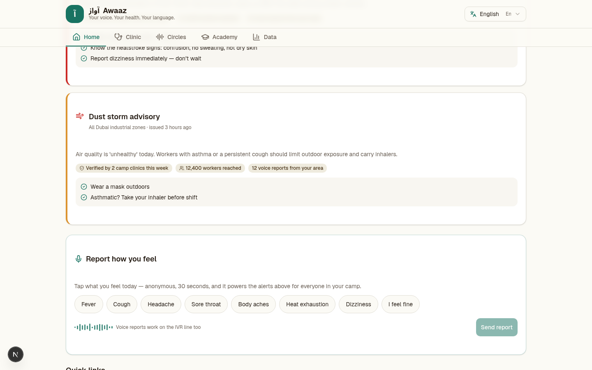
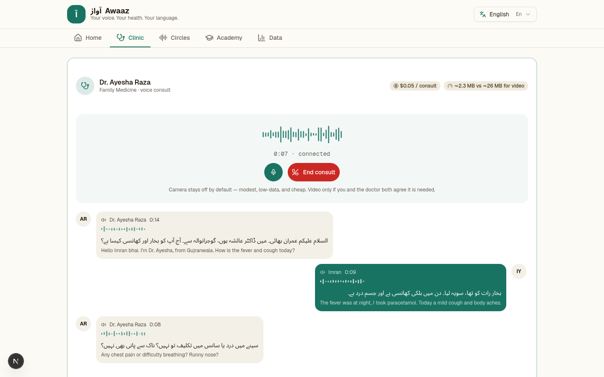
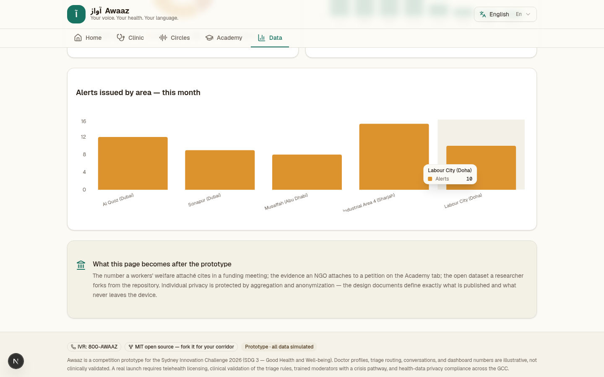
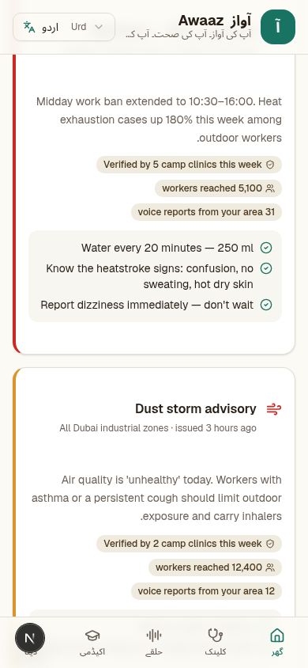

# آواز Awaaz

**A voice-first health companion for South Asian migrant workers in the Gulf.**

Built for the Sydney Innovation Challenge 2026 (SDG 3 — Good Health and Well-being). Free, open source, and designed to be forked for any worker corridor, not just this one.

🔗 **Live demo:** `https://<your-username>.github.io/awaaz/` — replace with your actual GitHub Pages URL once deployed (see below).

## What it is

Around 35 million foreign workers live in the six Gulf states, roughly 19 million of them from South Asia. On average-sized estimates, some 10,000 South Asian migrant workers die in the Gulf every year, more than half from causes never fully explained. Language barriers, unfamiliar health systems, and camp-based living all make routine care harder to reach than it should be.

Awaaz follows one worker through four connected moments:

| Screen | What it does |
|---|---|
| **Home** | Outbreak, heat, and hygiene alerts for your camp or area, in your language |
| **Clinic** | A short triage chat routes you to self-care advice, a low-bandwidth voice consult with a language-matched doctor, or in-person care if it's urgent |
| **Circles** | Audio-only peer support rooms, moderated, with a permanent one-tap escalation to real help |
| **Data** | Anonymized, aggregated numbers anyone can cite — the same evidence a local advocacy group would use to ask for more clinic funding |

It's voice-first on purpose: camera off by default on every consult, and no video-based peer matching at all — both a lower-bandwidth, more private, and simply safer design for a feature meant to help isolated people connect.

## This is a prototype

Everything in this build is simulated: doctor profiles, triage routing, peer-circle conversations, and dashboard numbers are all illustrative, not clinically validated or connected to a real directory, and the app says so on-screen. A real deployment would need actual telehealth licensing and doctor partnerships, clinical validation of the triage logic, trained human moderators with a genuine crisis pathway, and health-data privacy compliance. None of that exists yet — this repo is the interaction design and the case for building it, not a live medical service.

## Screenshots

<p float="left">
  
  
</p>
<p float="left">
  
  
</p>

## Running it locally

```bash
npm install
npm run dev
```

Open `http://localhost:3000`.

## Deploying your own copy to GitHub Pages

This repo already includes a GitHub Actions workflow (`.github/workflows/deploy.yml`) that builds and deploys automatically. To turn it on for your fork:

1. Push this repo to GitHub under your own account.
2. In the repo's **Settings → Pages**, set **Source** to **GitHub Actions**.
3. Push to `main` (or re-run the workflow from the **Actions** tab). The first run takes a couple of minutes.
4. Your site will be live at `https://<your-username>.github.io/<repo-name>/`.

The build automatically detects your repository name at build time — you don't need to edit any config for this to work, whatever you name the repo.

To preview a production build locally before pushing: `npm run build`, then `npm run preview`.

## Tech stack

Next.js (static export), React, TypeScript, Tailwind CSS, shadcn/ui, Zustand for state, Recharts for the dashboard. No backend, no database, no server required — the whole thing runs as static files, which is what makes free hosting on GitHub Pages possible.

## Contributing

Awaaz is MIT-licensed specifically so it can be forked for a different worker corridor, a different language set, or just made better. Changes go through pull requests and review — see [`CONTRIBUTING.md`](./CONTRIBUTING.md).

## License

MIT — see [`LICENSE`](./LICENSE). Use it, fork it, ship it somewhere it can help.
